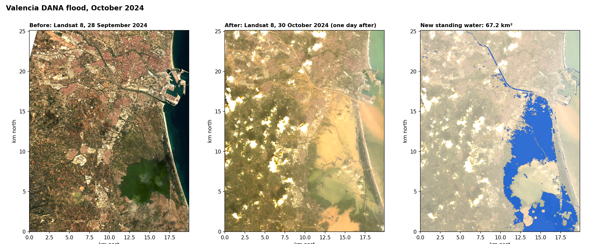
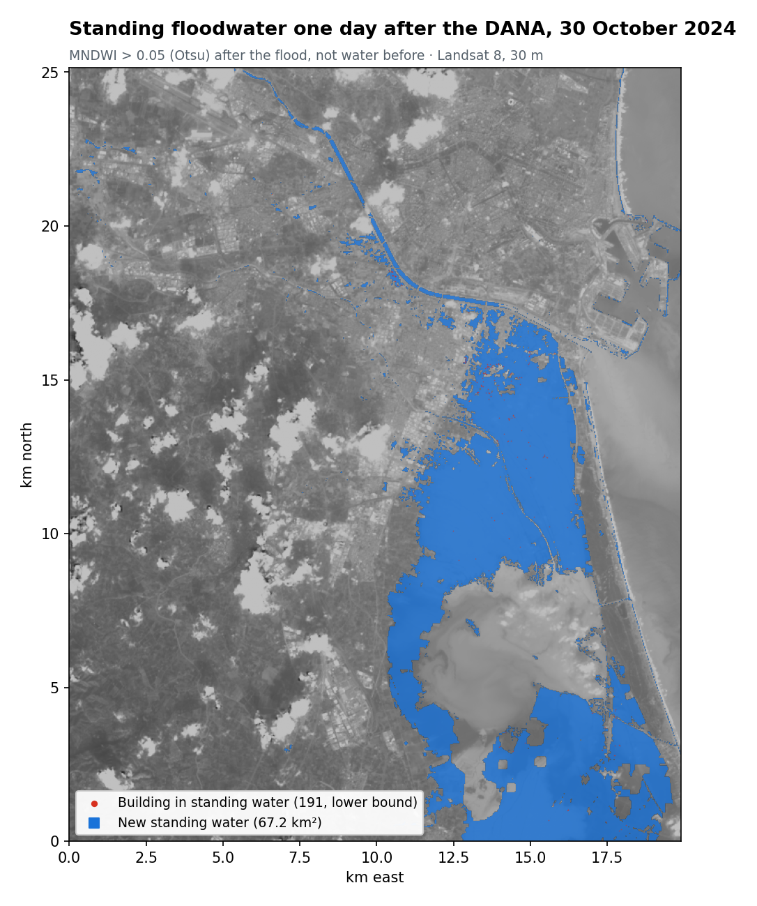
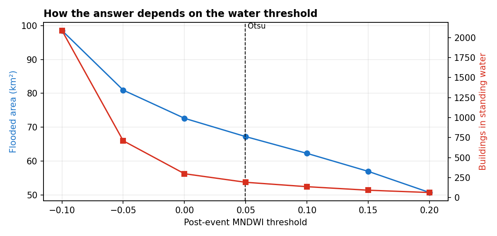
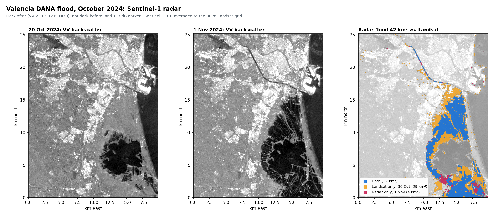
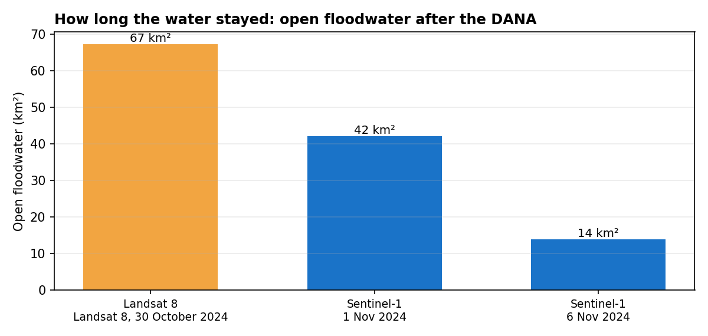
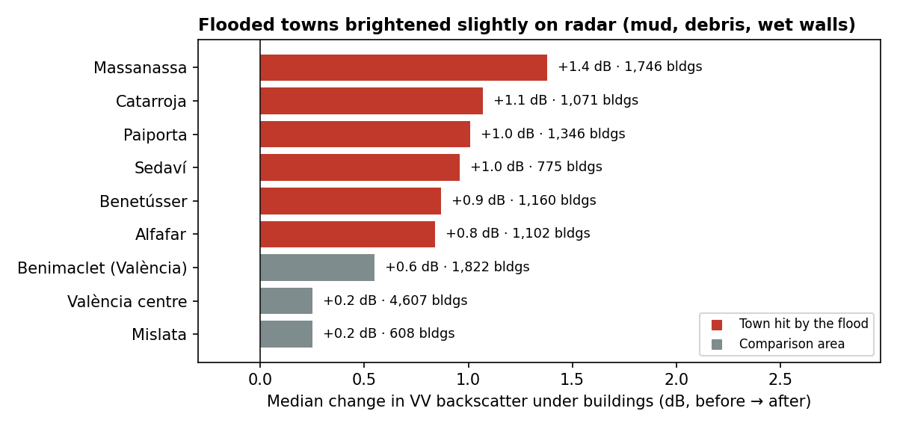

# Valencia DANA Flood, October 2024

[](https://github.com/7ao6688-hash/valencia-flood-2024/actions/workflows/ci.yml)
[](https://www.python.org/)
[](LICENSE)

On 29 October 2024 a cut-off low (*DANA*) dropped more than a year's rain in hours on the Valencia region, flooding the towns of L'Horta Sud and the Albufera wetland. This project maps the **standing floodwater visible from Landsat 8 one day later** and counts the buildings sitting in it. The pipeline fetches the satellite data automatically from Microsoft Planetary Computer, so anyone can rerun it with one command.



## Results

| | Value |
|---|---:|
| New standing water on 30 Oct 2024 (study area 20 × 25 km) | **67.2 km²** |
| Range as the water threshold varies ±0.15 | 50.7 – 98.6 km² |
| OSM buildings in the study area | 79,181 |
| Buildings whose footprint centre is in standing water | **191** (lower bound, see below) |



The water mapped here covers the rice paddies and fields around the Albufera, the new Turia channel and low ground towards the coast. Water that was already there before the flood (the sea, the lake and the canals) is excluded automatically.

### Why so few buildings?

The worst-hit towns (Paiporta, Catarroja, Alfafar…) drained within hours and were left under mud. In the 30 October image their streets read as wet soil, not open water, and at 30 m resolution a narrow flooded street is mixed with roofs anyway. **Optical water indices measure standing water at the moment of the overpass, not everywhere that flooded.** The building figure is therefore a lower bound. The Sentinel-1 section below shows a small but consistent radar signal over these towns; mapping urban impact street by street still needs very-high-resolution imagery or the official Copernicus EMS EMSR773 delineation.



## Sentinel-1 radar: through the cloud, and over time

Radar doesn't need sunlight or clear skies. Calm water mirrors the pulse away from the satellite, so flooded fields turn dark. The same study area was mapped from Sentinel-1 (VV, descending orbit 110), comparing **20 October with 1 November 2024**, the first radar pass after the flood.



| | Value |
|---|---:|
| Open floodwater on 1 Nov (radar) | **42.1 km²** |
| Landsat flood (30 Oct) still under water on 1 Nov | 38.6 km² (**57%**) |
| Water seen only by radar | 3.5 km² |
| Open floodwater on 6 Nov (orbit 8, 25 Oct → 6 Nov) | **13.9 km²** |

The two sensors agree on where the large bodies of water were: the paddies north and south of the Albufera. Over the following week the radar shows the water draining, from 67 km² on 30 October (Landsat) to 42 km² on 1 November and 14 km² on 6 November.



**What radar adds in the towns.** Open-water mapping misses the worst-hit towns, because they had already drained. Radar, however, shows that their buildings brightened by **+0.8 to +1.4 dB**, compared with +0.25 to +0.55 dB in unflooded parts of València. The likely cause is mud, debris and wet walls strengthening the double-bounce return. It's a consistent but small signal, too weak to classify street by street at 30 m, so it is reported per town rather than mapped.



| Radar step | Detail |
|---|---|
| Data | Sentinel-1 RTC (radiometrically terrain-corrected γ⁰, 10 m) from Microsoft Planetary Computer, averaged onto the 30 m Landsat grid. Two frames per pass are mosaicked |
| Speckle | 3 × 3 mean filter in linear power |
| Threshold | Otsu on post-event VV in dB (−12.3 dB) |
| New water | Dark after, not dark before, **and** at least 3 dB darker. Permanent water (sea, lake) is dark on both dates and drops out |
| Towns | Median VV change under OpenStreetMap building centres within 1 km of each town centre |

```bash
flood-map-sar case-studies/valencia-2024/case.json --buildings path/to/gis_osm_buildings_a_free_1.shp
```

The 6 November figure uses a different orbit (8) and its own pre-event image (25 October), and covers 83% of the area, so read it as a trend, not an exact like-for-like measurement.

## Method

| Step | Detail |
|---|---|
| Image pair | Landsat 8 Collection 2 Level-2, path/row 198/033: **28 Sep 2024** (before) and **30 Oct 2024** (after). Same sensor and orbit, so the grids match pixel for pixel |
| Cloud | QA_PIXEL fill, dilated cloud, cloud and shadow bits removed; 91% of the area is clear on both dates |
| Water index | MNDWI = (Green − SWIR1)/(Green + SWIR1) (Xu, 2006) |
| Threshold | Otsu on the post-event MNDWI histogram (0.05). Its land and water peaks sit at about −0.28 and +0.40 |
| New water | MNDWI_after > threshold **and** MNDWI_before ≤ 0 |
| Exposure | OpenStreetMap building footprints; a building counts if its representative point lies in new water |

## Run it

```bash
python -m pip install -e .
flood-map case-studies/valencia-2024/case.json --buildings path/to/gis_osm_buildings_a_free_1.shp
python -m unittest discover -s tests -v
```

Scenes are read straight from Planetary Computer. Only the study-area window is downloaded, and it's cached in `data/cache/`. Use `--local-dir` to read USGS downloads instead. Building footprints come from the Geofabrik *valencia* OpenStreetMap extract; they aren't stored here because of the ODbL share-alike terms. To map another event, copy `case.json` and change the scene IDs and bounding box.

## Limits

- **One overpass.** Water that had drained by 10:50 UTC on 30 October is missed, and so are urban streets.
- **Rice paddies.** Some Albufera paddies are deliberately flooded in autumn. A same-season baseline from a normal year would separate that from floodwater.
- **No validation.** The extent hasn't been compared with Copernicus EMS EMSR773 or field data, which would be the next step.
- Very turbid water can drop below the MNDWI threshold. The sensitivity curve shows how much area depends on that choice.

## Context

The original MSc coursework (University of Southampton, 2025) looked at built-up index (NDBI) change around Valencia using Landsat. This rebuild reframes it as a standing-water flood map, using a cloud-free pair from the same orbit and an automated, reproducible data source.

## Data and licences

Landsat 8 courtesy of the U.S. Geological Survey; Copernicus Sentinel-1 data 2024 (RTC product); both accessed via Microsoft Planetary Computer. Building footprints © OpenStreetMap contributors (ODbL). Code: MIT, see [LICENSE](LICENSE).
